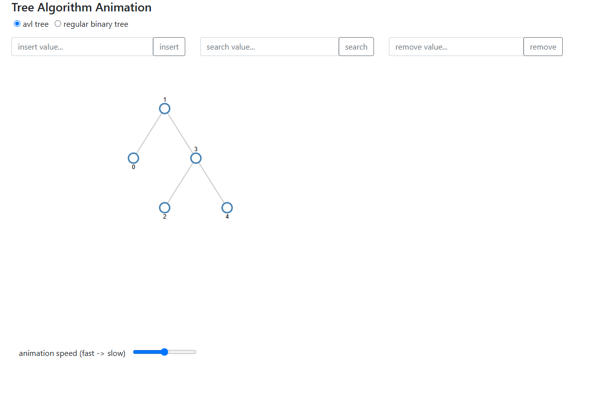
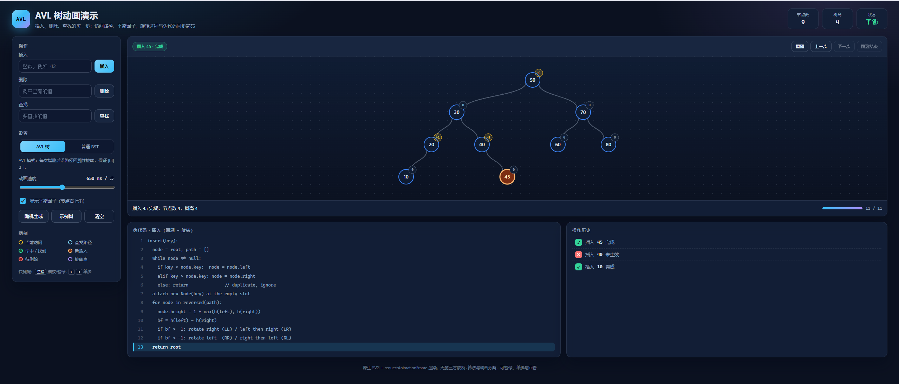

# AVL 树动画演示 · AVL Tree Visualizer

> **这个仓库只想说明一件事：同一道前端需求，五年之间（2021 → 2026），编程的成本与难度大约下降了 1000 倍。**

同一个需求的两个版本：

- **`v1/`** —— 2021 年的旧版。那年疫情在家闲着没事，接了一份课外小副业：帮一位学生做课程作业里的演示项目，前后断断续续写了 3 天；
- **`v2/`** —— 2026 年由 DeepSeek 4.1 Flash 用约半小时重写的新版。

两个版本留在一起，既当作品，也当一次「同一道题、不同年代与工具」的对照实验。

## 「1000 倍」是怎么算的

先把两版的可比数据摆出来：

| 口径 | v1（2021） | v2（2026） | 倍数 |
| --- | --- | --- | --- |
| 现金成本 | 1200 元（≈167 美元） | 约 0.17 美元（≈1.2 元 API 费） | **≈1000×** |
| 人的工时 | 3 天，断断续续（≈24 小时） | 约 30 分钟，一次对话 | ≈50× |
| 需求沟通 | 按作业要求来回确认、边写边改 | 一句话，无补充说明、无返工 | — |
| 交付质量 | 能演示，但有 bug 和半成品功能 | 功能完整，带 28 项自动化测试 | — |

1000 倍取的是最硬的「钱」这一口径：`1200 元 ÷ 1.2 元 = 1000`。
（汇率按 1 美元 ≈ 7.2 元；v2 的费用按 API 账单估算，量级在一元上下。）

工时只降了约 50 倍，但被抹掉的并不是打字速度，而是**门槛**。

## 难度降在哪里

**2021 年，要完成这件事，我得会：**

- D3 v3 的 `layout.tree`、enter / update / exit 三套选择集，以及它「不接受普通树节点」的数据转换；
- 自己把递归里的动画拆成 `async/await + setTimeout`，还要处理播放过程中的状态；
- 手动 debug 一处 `temp == root.left` 的恒假比较；没有测试，只能一遍遍点页面。

**2026 年，同样的需求，只需要：**

- 把「做什么」说清楚（这个仓库里就是一句话）；
- 判断结果对不对：跑一遍、看动画、跑测试。

也就是说，难点从「**怎么写**」挪到了「**要什么、怎么验收**」。
过去一个课程作业级别的项目，门槛是「熟练某个库 + 能自己调 bug」；
现在这两项都可以被「一句话需求 + 一次生成 + 一套自动化测试」覆盖。

## 但这个 1000 倍有边界

这是一个「一次性、自包含、无历史包袱、可本地验证」的演示项目，恰好落在 AI 收益最高的区间。
换成下面这些场景，降幅远没有三个数量级：

- **遗留系统**：不能推倒重写，只能在不破坏现状的前提下改；
- **模糊需求**：没人能用一句话说清「做成什么样」；
- **长尾维护**：五年后的兼容、依赖升级、线上事故；
- **责任归属**：出错要有人签字。代码可以生成，责任不能。

所以更准确的说法是：**这一类小项目的边际成本下降了约三个数量级**，
而不是「编程这件事已经不值钱了」。真正变贵的反而是判断力 —— 知道该让它生成什么，以及生成的东西哪里不对。

## 目录

| 目录 | 说明 | 技术栈 |
| --- | --- | --- |
| `v1/` | 2021 年的旧版（课外小副业，手写 3 天） | D3 v3 + jQuery + Bootstrap，库文件都在本地 |
| `v2/` | 2026 年的重写版（DeepSeek 4.1 Flash，约半小时） | 原生 JavaScript + SVG，零依赖 |

两个版本都可以直接双击各自的 `index.html` 打开，不需要安装、构建或联网。

## 截图

**v1（2021，D3 v3 + jQuery + Bootstrap）**



**v2（2026，原生 SVG，零依赖）**



## v1/：5 年前的旧版

- **时间**：2021 年
- **作者**：我本人 —— 2021 年疫情在家闲着时接的一份课外小副业，帮一位学生做的课程作业（现在回看，就是一次很典型的小外包）
- **做了什么**：用 D3 v3 画树，用 `async/await` + `setTimeout` 一步步演示 AVL 的插入、删除、查找
- **现在看来的问题**：
  - 动画和算法写在同一套递归里，只能看着它播完，不能暂停、回退或重播
  - d3 v3 + jQuery + Bootstrap 三个大依赖（本地库文件约 330 KB）
  - 删除逻辑里有一处比较写错（`temp == root.left`），undo/redo 只写了一半就注释掉了
  - 没有测试，改一处逻辑只能靠手点
  - 布局固定 960×500、`depth * 100`，节点一多就挤在一起

这一版保留原样，只移动了目录，代码不做修改，作为历史存档和对照。
（页面会尝试从 CDN 加载 FontAwesome 图标，离线时只是少几个图标，不影响功能。）

## v2/：2026 年的重写版

- **时间**：2026 年
- **作者**：DeepSeek 4.1 Flash，约半小时（一次对话内完成）
- **思路**：算法只产出「每一步的树快照」，渲染层只负责画快照，播放器只负责推进索引 —— 三者彻底解耦
- **相比 v1**：
  - 零依赖，原生 SVG + `requestAnimationFrame`
  - 可暂停 / 上一步 / 下一步 / 跳到结束 / 重播
  - 中序遍历定 x，节点不重叠；平衡因子徽章、路径与旋转高亮、伪代码同步高亮、操作历史、统计
  - Node 端 14 项逻辑测试（含 400 次随机增删）+ 浏览器端 14 项 DOM 断言

详细设计与取舍见 [`v2/README.md`](v2/README.md)。

## 快速开始

```bash
# v2（推荐）：直接打开
start v2\index.html        # Windows
open v2/index.html         # macOS

# v2 逻辑测试
node v2/test/avl.test.js
```

浏览器端冒烟测试：打开 `v2/test/browser-check.html`，页面会列出 14 条 PASS/FAIL。

v1 直接打开 `v1/index.html` 即可；它依赖同目录下的 d3 / jQuery 文件，不需要额外安装。

## 一句话需求，交出了什么

v2 收到的全部需求就是这一句：

> 这个前端小项目，你来重新写一个版本。看看比我写的好吗

没有原型、没有技术栈要求、没有接口说明，中途也没有追加修改意见。

就完成度而言，v2 明显更高：v1 的撤销/重做只写了一半、删除逻辑有 bug、也没有测试；
v2 的功能全部可用，并通过了 28 项自动化测试。

## 两版对比

| 维度 | v1（2021） | v2（2026） |
| --- | --- | --- |
| 作者 | 我（2021，手写 3 天） | DeepSeek 4.1 Flash（约半小时） |
| 交付成本 | 1200 元 | ≈1.2 元（API 费） |
| 依赖 | d3 v3 / jQuery / Bootstrap | 无 |
| 动画控制 | 只能等它播完 | 暂停 / 单步 / 回看 / 跳转 / 重播 |
| 布局 | d3 `layout.tree`，固定 960×500 | 中序定 x、深度定 y，宽度自适应 |
| 展示信息 | 只有 key | key + bf + 路径 + 旋转 + 伪代码 + 日志 + 统计 |
| 失败反馈 | `alert` | 播放完整查找路径 + 状态栏 / 徽章 |
| 测试 | 无 | Node 14 项 + 浏览器 14 项 |
| 完成度 | 基础演示，有 bug / 半成品 | 功能完整，测试覆盖 |
| 代码量 | 约 450 行 main.js（逻辑与渲染混合） | 4 个模块，约 1700 行（含注释） |

## 说明

- 这个仓库的目的不是证明 v1 写得差，而是留一份可复核的样本：同一道题、五年时间、两种生产方式，成本分别记在两边。
- v1 是历史存档，页面本身保持原样；只把它移进了 `v1/`，内部相对路径不受影响。
- v2 是重写实现，不是对 v1 的逐行修补。
- 「半小时」指从收到「这个前端小项目，你来重新写一个版本…」那句话，到 v2 跑通、测试通过的总耗时。
- 数字口径：1200 元是 2021 年那单的实际收入，3 天按约 8 小时/天折算；v2 的 0.17 美元是按 API 账单估算的，不包含电费和人的验收时间。换成别的口径，倍数会变，但量级不变。
